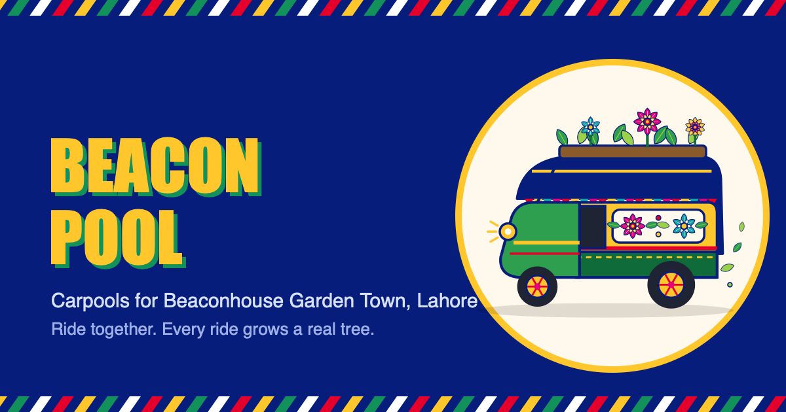

# Beacon Pool

**Carpools for Beaconhouse Garden Town, Lahore.** Students drop a pin, say whether they're driving or riding today, and find classmates going the same way. Every shared ride grows a tree in their *bagh*, and each tree is one the school plants for real.

**Live:** https://beaconpool.vercel.app



## How it works

1. **Drop your pin.** Search your area, tap a chip, use your location, or drag the map. Classmates only ever see a 300 m circle, never your house.
2. **Today I'm driving / riding.** Drivers see kids who need a ride and tap **Invite**. Riders see cars going their way with free seats and tap **Ask**. The other person says **Yes!** and you're carpooling.
3. **Your car.** A seat row shows who's in, who's waiting and what's free, plus pick-up times and the route on real Lahore roads.
4. **Ride stamps.** After the school run, tap today's circle. Every 22 kg of CO₂ saved grows a tree in your bagh.
5. **Gup Shup.** Chat with your carpool, with Urdu stickers.

## The numbers

| | |
|---|---|
| Petrol price | Rs 382.02 / litre (government rate, 21 Oct 2026) |
| Fuel economy | 11 km per litre, a typical 1000–1300 cc car in Lahore traffic |
| CO₂ | 2.31 kg per litre of petrol |
| Without a carpool | 4 trips a day per family (drop-off there and back, pick-up there and back) |
| One tree | 22 kg of CO₂, about what a grown tree absorbs in a year |
| School year | 190 days; pick-up times target the gate at 7:40 |

Routes are worked out on Lahore's main and connecting roads from OpenStreetMap.

## Devices

One responsive page: phones (iPhone and Android, portrait or sideways), tablets, and 16:9 / 16:10 laptops and monitors. It can be added to the home screen and opens full-screen.

## This version vs. the school version

This site is the **demo version**. Your spot, stamps and chats stay on your own device, and example classmates (marked *Example*) show how matching works. The school version adds:

- sign-in limited to Beaconhouse accounts (`@bh.edu.pk`)
- a shared database so real classmates see each other, send ride requests and chat
- chats visible only to the people in them

## Build

Everything ships as one page, `public/index.html`, built from `src/`:

```bash
python3 build.py
```

- `src/app.html`: the app's markup, styles and script
- `src/art/`: truck-art flowers, vine, rickshaw and icons (SVG)
- `src/data/lahore-roads.json`: Lahore road graph, canal and parks, simplified from OpenStreetMap

## Credits

Road, canal and park data © [OpenStreetMap](https://www.openstreetmap.org/copyright) contributors (ODbL). Fonts: Bungee, Rubik and Noto Nastaliq Urdu from Google Fonts.
